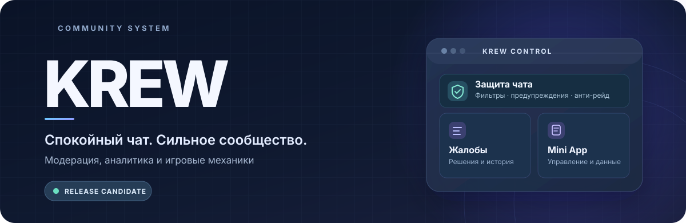

  

   
   

  
  
  
  

  <h3>Один бот. Порядок в чате. Живое сообщество.</h3>

  

    KREW объединяет инструменты модерации, обработку жалоб, аналитику
    и развлечения в единой системе для Telegram-групп.
  

  

    <a href="#возможности">Возможности</a> ·
    <a href="#как-устроен-krew">Как устроен</a> ·
    <a href="#релизы">Релизы</a> ·
    <a href="#статус-проекта">Статус</a>
  

---

## Возможности

| | Модуль | Что внутри |
| :---: | --- | --- |
| 🛡️ | **Shield** | Антиспам, ссылки, запрещённые слова, CAPS, массовые упоминания, капча и анти-рейд. |
| ⚖️ | **Reports** | Жалобы на сообщения, решения с указанием причины, журнал рассмотрений и личные уведомления. |
| 🎛️ | **Control Center** | Настройки группы, инструменты модераторов, аналитика и история действий в Telegram Mini App. |
| ✨ | **Community** | Профили, XP, уровни, достижения, игровые монеты, задания и рейтинги. |
| 🔄 | **Updates** | GitHub Releases, проверка целостности обновлений, резервные копии и новости версий по подписке. |

## Как устроен KREW

<pre>
Telegram-группа  →  KREW Bot  →  модерация и события
                         │
                         ├── SQLite · история и настройки
                         ├── Mini App · управление и аналитика
                         └── GitHub · код и релизы
</pre>

**Технологии:** Python 3.11+, Telegram Bot API, SQLite, веб-интерфейс Mini App и GitHub Actions.

**Принцип:** функции защиты и развлечения работают в одном боте, но настройки и данные разных групп разделены.

## Релизы

<table>
  <tr>
    <td><strong>Текущая версия</strong></td>
    <td><code>1.0.0-rc.3</code> · release candidate</td>
  </tr>
  <tr>
    <td><strong>Последний выпуск</strong></td>
    <td><a href="https://github.com/mrremka/-KREW-Bot/releases/latest">GitHub Releases</a> · <a href="https://github.com/mrremka/-KREW-Bot/releases/tag/v1.0.0-rc.3">RC3</a></td>
  </tr>
  <tr>
    <td><strong>Что изменилось</strong></td>
    <td><a href="CHANGELOG.md">История версий</a></td>
  </tr>
</table>

Новые сборки публикуются через GitHub Actions после автоматических проверок. Краткое описание обновления включается в каждый релиз.

## Статус проекта

> **KREW находится на стадии релиз-кандидата.** Основные функции и автоматические тесты реализованы, но перед стабильной версией ещё необходимы полноценные проверки в реальных Telegram-группах, с HTTPS и под нагрузкой.

  Designed for better Telegram communities · KREW

